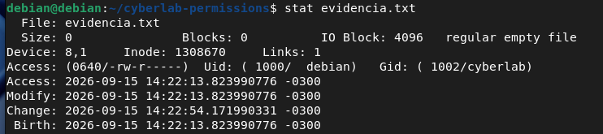
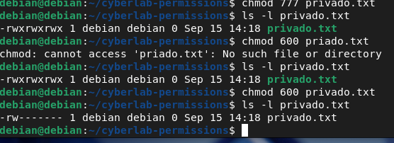

# 📸 Evidências Técnicas — Linux Security Fundamentals (Semana 03)

> Repositório de evidências visuais e relatórios de execução prática da **Semana 03** no CyberLab (`CyberLab-Debian`), cobrindo gestão de permissões POSIX, auditoria de metadados, *hardening* de permissões e análise do arquivo `/etc/sudoers`.

---

## 🎯 Sumário de Evidências

1. [Inspeção de Metadados de Arquivo com `stat`](#1-inspeção-de-metadados-de-arquivo-com-stat)
2. [Ajuste e Correção de Permissões Críticas (`chmod 777` → `600`)](#2-ajuste-e-correção-de-permissões-críticas-chmod-777--600)
3. [Verificação de Identidade e Privilégios Sudo](#3-verificação-de-identidade-e-privilégios-sudo)
4. [Mapeamento e Permissões do Arquivo `/etc/sudoers`](#4-mapeamento-e-permissões-do-arquivo-etcsudoers)

---

## 📸 Relatório de Evidências Práticas

### 1. Inspeção de Metadados de Arquivo com `stat`


* **O que a imagem demonstra:** Verificação detalhada de metadados do arquivo `evidencia.txt` no diretório `~/cyberlab-permissions` via comando `stat`.
* **Comando Executado:** `stat evidencia.txt`
* **Resultado:** Confirmação da permissão octal `0640` (`-rw-r-----`), vinculação ao usuário `debian` (UID 1000) e grupo `cyberlab` (GID 1002), além dos carimbos de data/hora (*Access*, *Modify*, *Change*, *Birth*).

---

### 2. Ajuste e Correção de Permissões Críticas (`chmod 777` → `600`)


* **O que a imagem demonstra:** Simulação de exposição indevida por permissões excessivas e posterior aplicação do Princípio do Menor Privilégio (*Hardening*).
* **Comandos Executados:**
  ```bash
  # 1. Exposição total (Risco de Segurança)
  chmod 777 privado.txt
  ls -l privado.txt

  # 2. Correção para acesso exclusivo do proprietário (Hardening)
  chmod 600 privado.txt
  ls -l privado.txt

```

* **Resultado:** O arquivo passou de totalmente vulnerável (`-rwxrwxrwx`) para estritamente protegido (`-rw-------`), garantindo leitura e escrita restritas ao proprietário.

---

### 3. Verificação de Identidade e Privilégios Sudo

* **O que a imagem demonstra:** Identificação do contexto de execução do usuário e auditoria de regras de elevação de privilégio.
* **Comandos Executados:**
```bash
whoami
id
sudo -l
sudo whoami

```


* **Resultado:** Confirmação da conta `debian` pertencente ao grupo `sudo` (GID 27), validação da regra de privilégio irrestrito `(ALL : ALL) ALL` e confirmação da elevação para `root`.

---

### 4. Mapeamento e Permissões do Arquivo `/etc/sudoers`

* **O que a imagem demonstra:** Mapeamento do diretório de trabalho do laboratório e verificação das permissões do arquivo sensível de administração de privilégios.
* **Comandos Executados:**
```bash
ls -l /etc/sudoers
ls -l /etc/sudoers.d/

```


* **Resultado:** Confirmação de que o arquivo `/etc/sudoers` possui permissão restrita de leitura `-r--r-----` (440) pertencente a `root:root`, impedindo modificações diretas sem o utilitário `visudo`.

---

## 🛡️ Tabela de Comandos & Aplicação para SOC / Investigação

| Comando | Função Técnica | Valor Investigativo / SOC |
| --- | --- | --- |
| **`stat <file>`** | Exibe inode, metadados e timestamps do arquivo | Análise forense de criação, modificação e alteração de permissões (*MACB timestamps*) |
| **`chmod 600`** | Define permissão exclusiva de leitura/escrita ao dono | Hardening de chaves SSH, arquivos `.env` e credenciais armazenadas em disco |
| **`id` / `whoami**` | Exibe UID, GIDs e grupos secundários | Identificação do contexto de execução de um usuário ou processo sob investigação |
| **`sudo -l`** | Lista as instruções permitidas no `/etc/sudoers` | Identificação de vetores de escalada de privilégios local (*Misconfigurations*) |

---

## 🔗 Projetos e Links Relacionados

* 🐧 [Laboratório Prático de Linux Security (Semana 03)](https://www.google.com/search?q=../../week-03/README.md)
* 🖥️ [Projeto Linux Troubleshooting](https://www.google.com/search?q=../../projects/linux-troubleshooting/README.md)
* 🧪 [CyberLab Infrastructure](https://www.google.com/search?q=../../projects/cyberlab/README.md)
* 🛣️ [Cybersecurity Roadmap (24 Semanas)](https://www.google.com/search?q=../../README.md)
