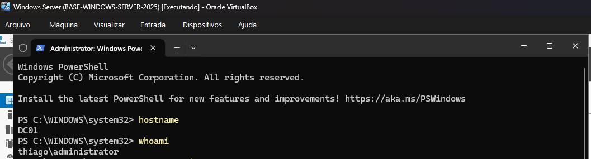
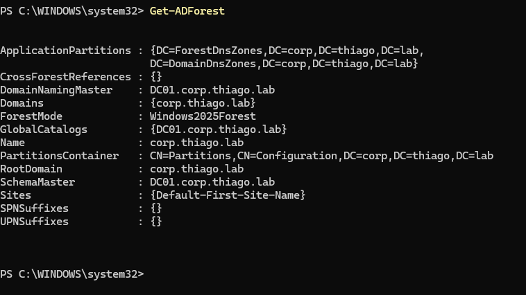
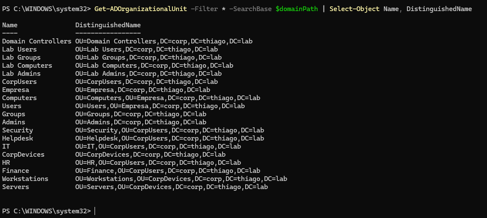
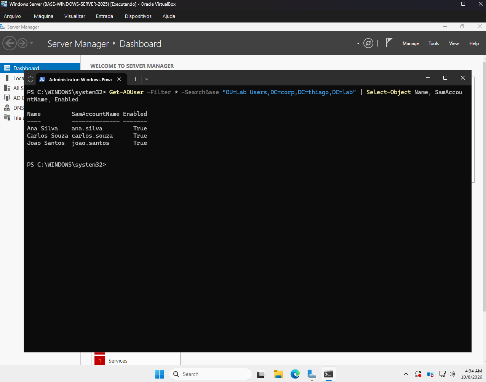
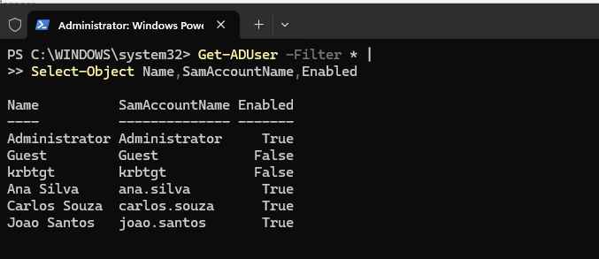

# 📸 Evidências Técnicas — Windows Server 2025 & Active Directory

> Repositório de evidências visuais e relatórios de execução prática do laboratório de **Windows Server 2025 Datacenter** (`DC01` / `corp.thiago.lab`), cobrindo a promoção a Controlador de Domínio, modelagem de OUs e grupos (IAM), aplicação de GPOs, baselines de senha e simulação/investigação de incidentes de autenticação via PowerShell.

---

## 🎯 Sumário do Laboratório

1. [Identificação do Servidor & Instalação](#1-identificação-do-servidor--instalação)
2. [Promoção a Controlador de Domínio & Floresta AD](#2-promoção-a-controlador-de-domínio--floresta-ad)
3. [Estruturação de Unidades Organizacionais (OUs)](#3-estruturação-de-unidades-organizacionais-ous)
4. [Gestão de Identidades (IAM) & Grupos Globais](#4-gestão-de-identidades-iam--grupos-globais)
5. [Políticas de Grupo (GPO) & Baseline de Senhas](#5-políticas-de-grupo-gpo--baseline-de-senhas)
6. [GPO de Segurança & Habilitação de Auditoria Local](#6-gpo-de-segurança--habilitação-de-auditoria-local)
7. [Simulação de Incidente de Logon & Análise de Logs (SOC)](#7-simulação-de-incidente-de-logon--análise-de-logs-soc)

---

## 📸 Relatório de Evidências Práticas

### 1. Identificação do Servidor & Instalação


* **O que a imagem demonstra:** Verificação inicial das propriedades do host no Windows PowerShell no servidor `DC01`.
* **Comandos:** `hostname` e `whoami`.
* **Resultado:** Confirmação do nome do servidor (`DC01`) e da conta de administração local atrelada (`thiago\administrator`).

---

### 2. Promoção a Controlador de Domínio & Floresta AD


* **O que a imagem demonstra:** Validação do provisionamento da floresta e do domínio Active Directory após promoção do servidor.
* **Comando:** `Get-ADForest`.
* **Resultado:** Floresta criada no nível funcional `Windows2025Forest`, com o domínio raiz `corp.thiago.lab` e os FSMO Roles alocados em `DC01.corp.thiago.lab`.

---

### 3. Estruturação de Unidades Organizacionais (OUs)


* **O que a imagem demonstra:** Mapeamento da árvore de Unidades Organizacionais do domínio para segregação de ativos e usuários.
* **Comando:** `Get-ADOrganizationalUnit -Filter * -SearchBase $domainPath | Select-Object Name, DistinguishedName`.
* **Resultado:** Confirmação da estrutura hierárquica criada (`CorpUsers`, `CorpDevices`, `Workstations`, `Servers`, `Security`, `Helpdesk`, `IT`, `HR`, `Finance`).

---

### 4. Gestão de Identidades (IAM) & Grupos Globais

#### A. Criação de Contas na OU e Listagem Global
| Usuários na OU Lab Users | Listagem Geral de Contas do Domínio |
| :---: | :---: |
|  |  |
| <sub>*Filtro de usuários na OU `OU=Lab Users,DC=corp,DC=thiago,DC=lab`*</sub> | <sub>*Listagem de contas ativas e do sistema (`Administrator`, `krbtgt`)*</sub> |

* **Comandos:** 
  ```powershell
  Get-ADUser -Filter * -SearchBase "OU=Lab Users,DC=corp,DC=thiago,DC=lab" | Select-Object Name, SamAccountName, Enabled
  Get-ADUser -Filter * | Select-Object Name, SamAccountName, Enabled
---
#### B. Mapeamento de Objetos AD e Membros de Grupos de Segurança

- Mapeamento de CN e DN de Usuários e Computadores
DistinguishedName das contas e do computador DC01
- Associação a Grupos Globais (GG-*)
Membros dos grupos GG-SOC-Analysts, GG-IT-Support e GG-Helpdesk

* **Atribuição do Modelo RBAC / Least Privilege:**

* Ana Silva → GG-SOC-Analysts

* Carlos Souza → GG-IT-Support

* João Santos → GG-Helpdesk

* **Comando de validação:**
   Get-ADPrincipalGroupMembership <usuario> | Select-Object Name

### 5. Políticas de Grupo (GPO) & Baseline de Senhas

* O que a imagem demonstra: Aplicação e ajuste da política padrão de senhas do domínio (Default Domain Password & Lockout Policy).

* Comando:

  Set-ADDefaultDomainPasswordPolicy -Identity "corp.thiago.lab" `
  -MinPasswordLength 12 `
  -ComplexityEnabled $true `
  -MaxPasswordAge (New-TimeSpan -Days 90) `
  -MinPasswordAge (New-TimeSpan -Days 1) `
  -PasswordHistoryCount 5 `
  -LockoutThreshold 5 `
  -LockoutDuration (New-TimeSpan -Minutes 15) `
  -LockoutObservationWindow (New-TimeSpan -Minutes 15)

* **Resultado:** Baseline de complexidade, tamanho mínimo de 12 caracteres e bloqueio de conta configurados com sucesso.

### 6. GPO de Segurança & Habilitação de Auditoria Local

* **O que a imagem demonstra:** Criação da GPO GPO-Workstations-Security-Baseline, vinculação à OU OU=Workstations,OU=CorpDevices e ativação de subcategorias de auditoria via auditpol.
* Comandos:

New-GPO -Name "GPO-Workstations-Security-Baseline" -Comment "Baseline de Seguranca e Auditoria"
New-GPLink -Name "GPO-Workstations-Security-Baseline" -Target "OU=Workstations,OU=CorpDevices,DC=corp,DC=thiago,DC=lab"
auditpol /set /subcategory:"Logon" /success:enable /failure:enable
auditpol /set /subcategory:"User Account Management" /success:enable /failure:enable
auditpol /set /subcategory:"Security Group Management" /success:enable /failure:enable
gpupdate /force

### 7. Simulação de Incidente de Logon & Análise de Logs (SOC)

* **O que a imagem demonstra:** Simulação prática de uma tentativa de autenticação incorreta (falha de logon) e posterior extração dos campos de auditoria em XML via PowerShell.
* Procedimento:

1- Tentativa de logon com senha incorreta para a conta corp\ana.silva via Start-Process powershell -Credential $cred.

2 - Leitura do log de evento de segurança Event ID 4625 (Falha de Logon).

3 - Extração estruturada dos campos em objeto customizado (DataHora, UsuarioTentado, Dominio, TipoLogon, IPOrigem, CodigoStatus).

4 - Leitura do evento Event ID 4624 (Logon Realizado com Sucesso).

* **Resultado para Análise Defensiva (SOC):** Confirmação da geração do log de evento e validação da capacidade de extração de indicadores de comprometimento (IoCs) via automação PowerShell.

---

## 🛡️ Tabela de Event IDs Validados

| Event ID | Tipo | Descrição Técnica |
| :---: | :---: | :--- |
| **4624** | Sucesso | Logon realizado com sucesso na rede/estação |
| **4625** | Falha | Tentativa de logon inválida (código de erro `0xc000006d` / credencial incorreta) |
| **4720** | Alteração | Nova conta de usuário criada no Active Directory |
| **4728** | Alteração | Membro adicionado a um grupo de segurança global |

---

## 🔗 Projetos Relacionados

* 🖥️ [Laboratório Prático de Active Directory](https://github.com/thiagoalphabsb/cybersecurity-roadmap/blob/main/projects/windows-server-2025)
* 🧪 [CyberLab Infrastructure](https://github.com/thiagoalphabsb/cybersecurity-roadmap/blob/main/portfolio/cyberlab)
* 🛣️ [Cybersecurity Roadmap (24 Semanas)](https://github.com/thiagoalphabsb/cybersecurity-roadmap)

  
