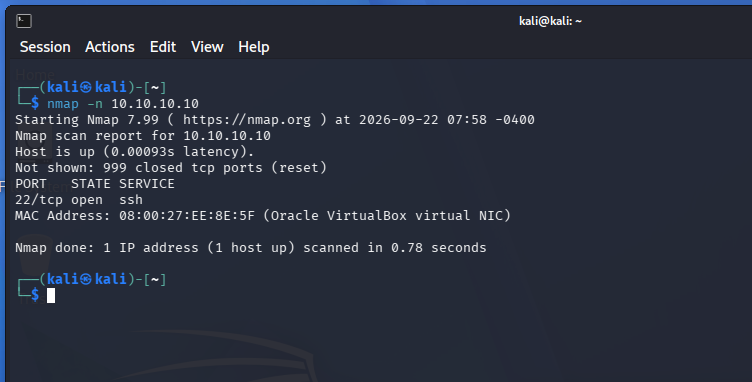
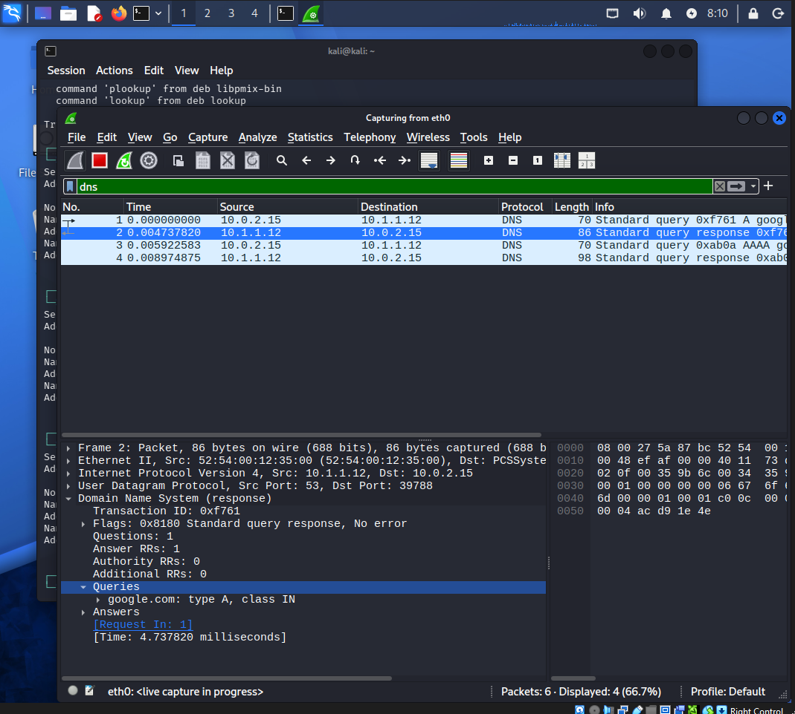
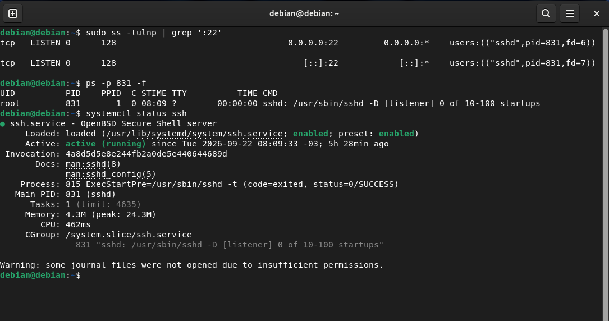
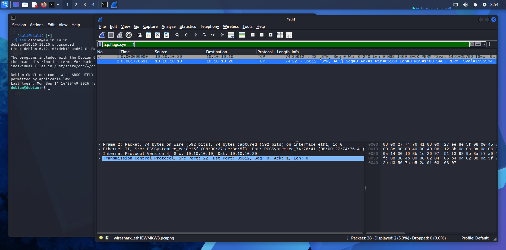
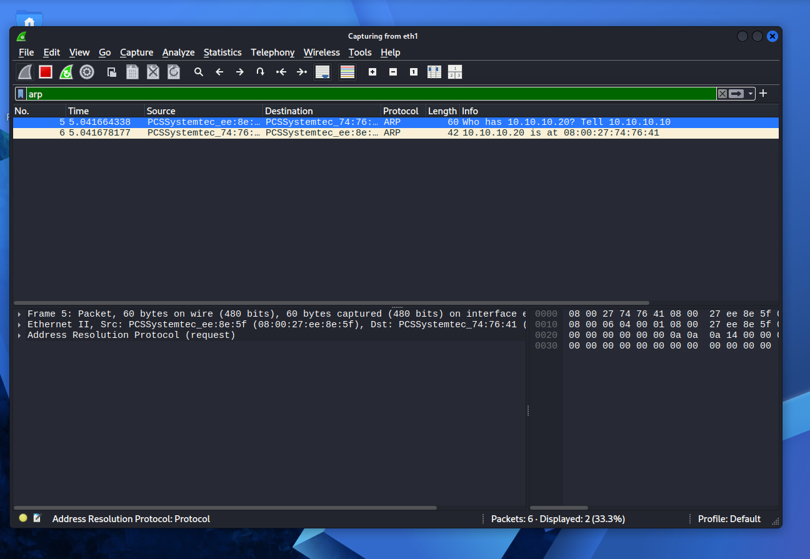
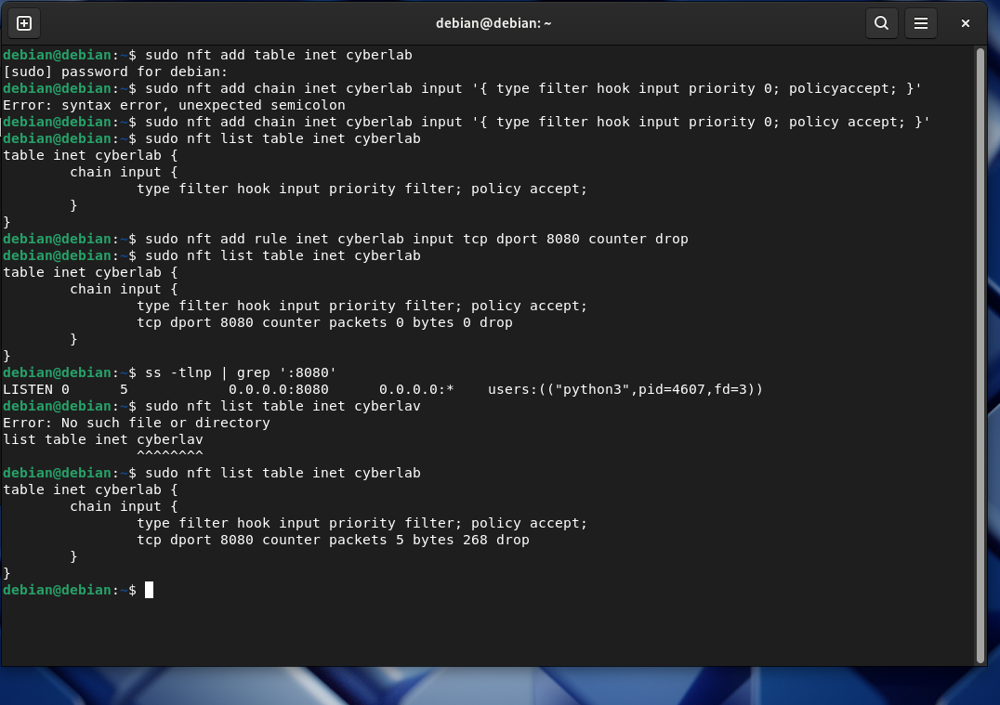

# 🌐 Network Analysis & Investigação Defensiva
> **Área:** Análise de tráfego, protocolos de rede e segurança defensiva (Blue Team / SOC)  
> **Ambiente:** CyberLab isolado — Debian 13 e Kali Linux  
> **Status:** Concluído

Este projeto documenta um laboratório prático de análise de rede em ambiente controlado. O foco foi correlacionar evidências de diferentes camadas — endereços IP e MAC, conexões TCP, resolução DNS, regras de firewall e processos do Linux — para explicar o que ocorreu durante os testes.

> **Escopo:** exercício educacional de laboratório. Os resultados descritos referem-se ao ambiente e ao momento dos testes, não a uma investigação de incidente real em produção.

## 🎯 Objetivos

- Identificar serviços e portas expostos no host de laboratório.
- Observar conexões TCP e consultas DNS no Wireshark.
- Relacionar IPs, endereços MAC, sockets, processos e serviços.
- Criar e validar regras de filtragem com `nftables`.
- Registrar procedimentos e resultados com evidências reproduzíveis.

## 🧠 Modelo de investigação

A sequência abaixo serve como roteiro de correlação, não como uma cadeia obrigatória para todo evento:

```text
DNS / Nome → IP → ARP / MAC → Conexão e porta → Firewall
                                      ↓
                            Socket → Processo / PID
                                      ↓
                               Logs e contexto
```

Cada fonte responde a perguntas diferentes. Uma captura de pacotes, por si só, não prova qual processo local gerou o tráfego; por isso, ela deve ser correlacionada com informações do host, como `ss`, `ps` e o estado do serviço.

## 🏗️ Topologia do laboratório

O laboratório utiliza uma rede privada Host-Only do VirtualBox, isolada da rede externa para os testes descritos.

```text
                    CYBERLAB — 10.10.10.0/24
                         Rede Host-Only
                                |
                 +--------------+--------------+
                 |                             |
          CyberLab-Debian                CyberLab-Kali
          Debian GNU/Linux 13              Kali Linux
          10.10.10.10/24                  10.10.10.20/24
          Host analisado                  Estação de análise
```

| Máquina | Endereço IP | Função no exercício |
|---|---|---|
| Debian 13 | `10.10.10.10/24` | Host analisado; serviço SSH e inspeção de processos e sockets |
| Kali Linux | `10.10.10.20/24` | Estação de auditoria para conectividade, Nmap e Wireshark |

## 🛠️ Ferramentas e técnicas

| Ferramenta / protocolo | Camada ou contexto | Uso no laboratório |
|---|---|---|
| **Wireshark** | L2–L7 | Inspecionar pacotes, handshake TCP e consultas DNS |
| **Nmap** | Rede e transporte / aplicação | Identificar portas acessíveis e serviços detectáveis |
| **`nftables`** | Firewall do host | Criar regras `accept`/`drop` e observar contadores |
| **`ss` e `ps`** | Sistema operacional | Correlacionar sockets, portas e processos |
| **`systemctl`** | Serviços Linux | Consultar o estado de serviços gerenciados pelo systemd |
| **`dig` e `nslookup`** | DNS | Consultar nomes e observar respostas DNS |
| **`ip addr` e `ip neigh`** | L2–L3 | Verificar interfaces, endereços e vizinhos da rede |

## 🔬 Casos práticos e evidências

### Caso 01 — Reconhecimento de serviços e DNS

**Objetivo:** identificar serviços acessíveis no host Debian e observar consultas DNS.

**Resultado registrado:** o Nmap identificou a porta `22/tcp` como aberta para SSH. Consultas DNS foram realizadas com `dig`/`nslookup` e observadas no Wireshark.

**Evidência 1 — Reconhecimento com Nmap**



**Evidência 2 — Consulta e resposta DNS no Wireshark**



### Caso 02 — Correlação entre conexão, socket e processo

**Objetivo:** combinar a observação de tráfego com a inspeção do host.

**Resultado registrado:** a porta `22/tcp` foi associada ao serviço SSH no Debian; o estabelecimento da conexão TCP foi observado no Wireshark. O PID e o estado do serviço são informações dependentes da execução do laboratório e podem mudar após reinicializações ou novas sessões.

**Evidência 3 — Socket, processo e serviço**



**Evidência 4 — SYN TCP no Wireshark**



### Caso 03 — ARP e filtragem com nftables

**Objetivo:** observar a resolução de vizinhos na rede local e validar uma regra de filtragem no host.

**Procedimento registrado:** foram observadas mensagens ARP entre as máquinas e realizados testes com regras `nftables` para o tráfego TCP destinado à porta `8080`. Os contadores da regra foram usados para verificar se os pacotes correspondiam à regra de descarte durante o teste.

**Evidência 5 — ARP no Wireshark**



**Evidência 6 — Contador da regra de descarte**



## 📑 Resumo técnico dos resultados

| Item | Resultado registrado |
|---|---|
| Host analisado | Debian GNU/Linux 13 (Trixie), `10.10.10.10` |
| Estação de análise | Kali Linux, `10.10.10.20` |
| Reconhecimento | `22/tcp open (ssh)` no teste documentado |
| Serviço SSH | OpenSSH `10.0p2 Debian 7+deb13u4`, conforme a saída registrada |
| TCP | Handshake SYN → SYN/ACK → ACK observado no Wireshark |
| DNS | Consultas e respostas analisadas com ferramentas de consulta e captura |
| ARP | Relação entre endereços IP e MAC observada na rede local |
| Firewall | Regras `nftables` testadas com tráfego TCP para a porta `8080` e contadores de regra |

Os resultados acima descrevem as evidências registradas no laboratório. Endereços, versões, PIDs, respostas DNS e estado das regras podem variar se o exercício for repetido em outro momento ou após alterações na configuração.

## 📈 Competências praticadas

- **Análise de tráfego:** aplicação de filtros no Wireshark e leitura de eventos TCP, DNS e ARP.
- **Reconhecimento de serviços:** interpretação dos resultados do Nmap dentro de um ambiente autorizado.
- **Investigação no Linux:** consulta de sockets, processos e serviços para complementar a observação da rede.
- **Firewall host-based:** criação e validação de regras `nftables`, incluindo leitura de contadores.
- **Documentação técnica:** registro de procedimento, resultado observado e evidências associadas.

## 🔗 Documentação e projetos relacionados

- [Evidências da Week 04](../../evidence/week04/)
- [README da Week 04 — Redes](../../week-04/README.md)
- [Índice da documentação técnica](../../docs/README.md)
- [CyberLab Infrastructure](../cyberlab/README.md)
- [Cybersecurity Roadmap](https://github.com/thiagoalphabsb/cybersecurity-roadmap)
- [Cybersecurity Portfolio](https://github.com/thiagoalphabsb/cybersecurity-portfolio)

---

*Projeto educacional desenvolvido como parte do Cybersecurity Roadmap, com foco em práticas defensivas de análise de rede e documentação baseada em evidências.*
